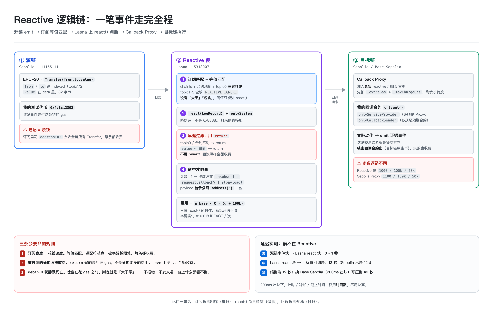

# Reactive Builder Camp 学习仓库

ETHPanda × Reactive Network 两周共学（2026-11-16 → 11-29）+ Reactive Omni Buildathon 参赛记录。

## 结业项目

**Reactive Guardian** — 热钱包异常转出自动保护：[github.com/xiapushan/reactive-guardian](https://github.com/xiapushan/reactive-guardian)

## 我是谁 / 目标

- WCB 用户名：`（填写）`
- 赛道意向：`（赛道 1 / 2 / 3，待定）`
- 一句话目标：`（例：用 Reactive 做一个钱包异常转出自动保护）`

## 进度

| 日期 | 内容 | 笔记 |
|---|---|---|
| 2026-11-13 | 环境搭好 + 首个端到端链路跑通（Sepolia ↔ Lasna ↔ Sepolia） | [notes/2026-11-13.md](notes/2026-11-13.md) |
| 2026-11-17 | 第 0 周任务提交（钱包 / lREACT / 仓库 / forge 版本） | [notes/2026-11-17.md](notes/2026-11-17.md) |
| 2026-11-18 | D1 用例拆解卡：钱包异常转出自动保护 | [notes/d1-use-case.md](notes/d1-use-case.md) |
| 2026-11-18 | D2 读懂费用：Lasna 系统合约三个参数实测 | [notes/d2-fees.md](notes/d2-fees.md) |
| 2026-11-18 | D3 第一次部署：监控 Sepolia 代币转账（上链实测） | [notes/d3-first-deploy.md](notes/d3-first-deploy.md) |
| 2026-11-22 | 核心概念复盘（订阅/费用/安全/地址/性能 + 自测题） | [notes/concepts-summary.md](notes/concepts-summary.md) |
| 2026-11-22 | D4【必做】跨链回调三步走 + 失败实验 | [notes/d4-cross-chain-callback.md](notes/d4-cross-chain-callback.md) |
| 2026-11-22 | D5 动态订阅：运行中增/删订阅（含退订耗尽余额实测） | [notes/d5-dynamic-subscription.md](notes/d5-dynamic-subscription.md) |
| 2026-11-28 | **D9【必做】跑通项目**：Reactive Guardian 首条完整链路 | [notes/d9-first-full-chain.md](notes/d9-first-full-chain.md) |

## 总结区

所有复盘、速查图、概念总结都在 [`summary/`](summary/README.md)。

**一图看懂逻辑链** → [summary/logic-chain.png](summary/logic-chain.png)

## 环境

> 按课程《新手指南》第 3 节模板填写。

- 操作系统：macOS（Apple Silicon）
- Foundry 版本：`1.9.0`（Solc `0.8.29`）
- 测试钱包地址：`0xf8a9863c156CCc444ccD666Fe7000dF7F5760A31`
- Lasna 地址页链接：https://lasna.reactscan.net/address/0xf8a9863c156CCc444ccD666Fe7000dF7F5760A31
- 本地测试结果：`forge test -vv` → **8 passed / 0 failed**（见 [notes/2026-11-13.md](notes/2026-11-13.md)）
- 模板仓库：https://github.com/ethpanda-org/reactive-builder-camp
- Omni 写法参考（**不要用旧 ReactVM 写法**）：https://dev.reactive.network/reactive-contracts

## 遇到的问题

| 正在做哪一步 | 报错 | 解决方式 |
|---|---|---|
| MetaMask 切换 Sepolia | 新版 App 找不到「显示测试网络」开关 | 不用 UI 切网络，改由 `cast --rpc-url` 决定链 |
| `forge script` 部署 | `vm.envUint: missing hex prefix` | MetaMask 导出的私钥补上 `0x` |
| 部署脚本 | `cast: command not found` | 脚本内兜底把 `~/.foundry/bin` 注入 PATH |
| GitHub 添加 SSH key | 网页表单按钮灰着、无报错 | 改用 `gh auth login` 走 API 上传公钥 |

## 链上记录

| 步 | 链 | 地址 |
|---|---|---|
| ① 源链事件源 | Sepolia `11155111` | `0x4176Fd872507E10c7cFC5fe6c7FfaBd718CA13fD` |
| ② Reactive | Lasna `5318007` | `0xC223Fa471F6BB56e7983BEfeFd88464EDc720D8A` |
| ③ 回调 | Sepolia `11155111` | `0xd9Fb2389103779eCD5aFC0df64A3D9417C91aD80` |

三笔交易与延迟实测见 [notes/2026-11-13.md](notes/2026-11-13.md)。

## 安全

本仓库**不含任何私钥、助记词、API key**。`.env` 已在 `.gitignore` 中。全营只用测试网与测试钱包。
