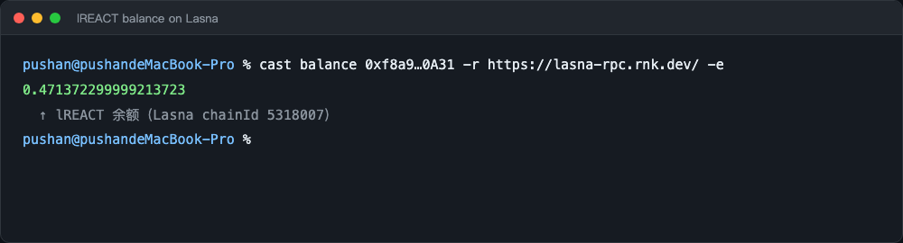
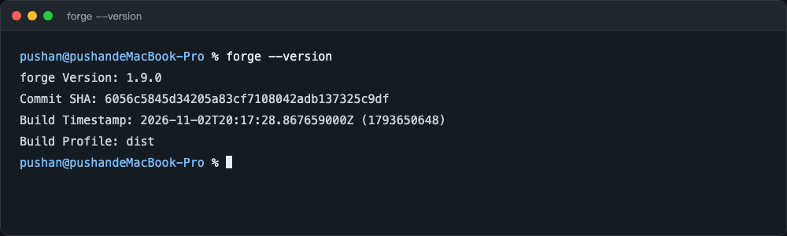

# 第 0 周任务提交材料

> 生成时间：2026-11-17（全部为链上实时查询结果，非手填）

---

## ① 测试钱包地址

```
0xf8a9863c156CCc444ccD666Fe7000dF7F5760A31
```

- 专用测试钱包，仅用于本期测试网，未与任何主网资产关联
- Sepolia 发过 1 笔（换 lREACT）、Lasna 发过 2 笔（部署 + 绑定回调）
- 地址校验：42 字符，EIP-55 校验和通过

---

## ② Lasna 上持有 lREACT 的证据

### 区块浏览器链接（直接点开可查）

https://lasna.reactscan.net/address/0xf8a9863c156CCc444ccD666Fe7000dF7F5760A31

### 链上余额

```
0.471372299999213723 lREACT
```

### 命令核验

```bash
cast balance 0xf8a9863c156CCc444ccD666Fe7000dF7F5760A31 -r https://lasna-rpc.rnk.dev/ -e
# → 0.471372299999213723
```

### 截图



---

## ③ GitHub 学习仓库链接

https://github.com/xiapushan/reactive-learning

公开仓库，结构：

```
reactive-learning/
├── README.md           # 目标、进度表、链上地址
├── AI-CONTEXT.md       # 给 AI 的上下文（Omni 新写法约束）
├── .gitignore          # 挡 .env / key / out / cache
└── notes/
    ├── 2026-11-13.md   # 环境 + 端到端链路
    └── 2026-11-17.md   # 第 0 周提交
```

`.env` 与私钥已确认未进入仓库（`.gitignore` 首行拦截，`git ls-files` 扫描通过）。

---

## ④ forge --version 输出

```
forge Version: 1.9.0
Commit SHA: 6056c5845d34205a83cf7108042adb137325c9df
Build Timestamp: 2026-11-02T20:17:28.867659000Z (1793650648)
Build Profile: dist
```

### 截图



---

## 附加：模板仓库本地测试（任务里提到可以先跑）

```bash
cd reactive-builder-camp/starter && forge test -vv
```

```
Ran 8 tests for test/Camp.t.sol:CampTest
[PASS] test_subscribedInConstructor()        (gas:  18760)
[PASS] test_callbackRejectsWrongProxy()      (gas:  32723)
[PASS] test_originEmitsPing()                (gas:  35657)
[PASS] test_reactOnlySystem()                (gas:  37827)
[PASS] test_callbackRejectsWrongSender()     (gas:  38188)
[PASS] test_belowThresholdNoCallback()       (gas: 108848)
[PASS] test_fullLoop_eventToCallback()       (gas: 434081)
[PASS] test_limitReachedUnsubscribes()       (gas: 557749)
Suite result: ok. 8 passed; 0 failed; 0 skipped
```

> 8 个测试全部通过，不需要测试币。测试用 `vm.etch` 把 MockSystem 放到 `0x8888…8888`、用 MockProxy 模拟回调投递，整条链路本地就能跑通。

---

## 附加：已提前完成的第 1 周内容

环境准备好之后顺手把「第一次部署」和「跨链回调三步走」跑通了，材料在 `notes/2026-11-13.md`：

| 环节 | 交易哈希 |
|---|---|
| 源链 `ping(500)` | [0x85a95c13…](https://sepolia.etherscan.io/tx/0x85a95c13d86737122cd43d74d053f31dd9d7acd7ed2875ae4eea56b3177b618e) |
| Lasna `react()` | [0x0c1b80e0…](https://lasna.reactscan.net/tx/0x0c1b80e089cf4f4e4ac964d5b2a98486a413f463eabc29e8a43bc008b26ea9f9) |
| 目标链回调 | [0xda56e835…](https://sepolia.etherscan.io/tx/0xda56e83572d8763085d115960280baf743197e293dcee99a59075b95d98673dc) |

端到端延迟实测 12 秒（Sepolia 出块 12s 是瓶颈）。

---

## 填表时直接复制这几段

**测试钱包地址**
```
0xf8a9863c156CCc444ccD666Fe7000dF7F5760A31
```

**lREACT 证据链接**
```
https://lasna.reactscan.net/address/0xf8a9863c156CCc444ccD666Fe7000dF7F5760A31
```

**GitHub 仓库**
```
https://github.com/xiapushan/reactive-learning
```

**forge 版本**
```
forge Version: 1.9.0
```
