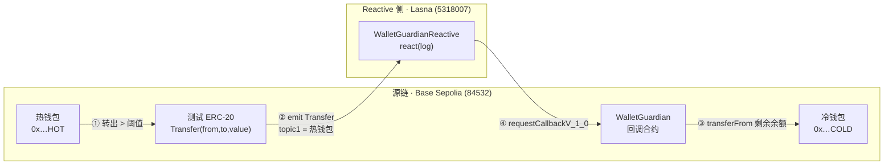

# D1 用例拆解卡｜钱包异常转出时的自动保护

> 任务：用例拆解卡（60 学分）· 2026-11-18
> 场景来源：课程页「场景手册」场景 2｜钱包守护（入门 → 进阶），对应黑客松赛道 2（Set It and Forget It）

---

## 一句话

**我的热钱包在链上转出任何一笔超过阈值的代币时，Reactive 立刻在 1 秒内把这笔钱之外剩下的代币全部转到冷钱包，把损失封顶。**

---

## 四个问题

### 1. 监听哪条链、哪个合约的什么事件？

| 项 | 值 |
|---|---|
| 链 | **Base Sepolia**（chainId `84532`）——200ms 出块，守护类场景响应速度最重要 |
| 合约 | 任意 ERC-20 代币合约（用 `address(0)` 通配不行，因为订阅只支持等值匹配，所以要逐个订阅；原型阶段先订阅 1 个自建的测试代币） |
| 事件 | `Transfer(address indexed from, address indexed to, uint256 value)` |
| topic0 | `cast keccak "Transfer(address,address,uint256)"` = `0xddf252ad1be2c89b69c2b068fc378daa952ba7f163c4a11628f55a4df523b3ef` |
| topic1 | 我的热钱包地址（`indexed` 的 `from`）——这样只收「我转出」，不处理别人转给我 |

**为什么用 topic1 精确过滤**：订阅只支持「等于」匹配。把 `from` 钉死成我的热钱包，别人的转账一条都不会进 `react()`。这直接决定了费用——事件订阅是按条收费的，通配所有 Transfer 会被刷爆。

### 2. 满足什么条件时触发？

`react()` 里依次判断，任一不满足就 `return`（**不是 revert**，revert 照样收费）：

```
① 代币在白名单里？（防止有人给任意假代币发 Transfer 来蹭我的自动化）
② value >= 单笔阈值？（低于阈值的小额转出不惊动守护，否则正常花钱也会触发）
③ guardianEnabled == true？（留一个总开关，出事时我能自己暂停）
④ 距上次执行 >= 冷却期？（同一次被盗可能连续多笔，别重复触发）
```

再加两条结构性约束：

- **次数上限**：`maxTriggers`（例如 3 次），用完自动退订，防止测试币被扣光
- **额度上限**：单次转移不超过冷钱包设定上限

### 3. 在哪条链做什么动作？

| 项 | 值 |
|---|---|
| 目标链 | **Base Sepolia**（与源链同链——代币和冷钱包都在同一条链上，不需要跨链桥） |
| 回调合约 | `WalletGuardian`（继承 `AbstractCallback`，加 `onlyServiceProvider` + `onlyCallbackSender` 两道校验） |
| 动作 | `token.transferFrom(热钱包, 冷钱包, 热钱包剩余余额)` |
| 前置 | 热钱包提前 `approve` 给 `WalletGuardian` 一个**明确的额度上限**（不是无限授权） |
| 证据 | 回调合约 emit `Guarded(token, amount, originTxHash)`，这笔交易哈希就是演示证据 |

**为什么不是「把代币转给一个临时地址」再人工处理**：守护的价值在于全自动、无需人在场。人不在的时候，多一步人工就是多一步失败。

### 4. 如果不用 Reactive，要怎么做？

**方案 A：自己跑机器人**

- 租一台 7×24 服务器，写监听循环（RPC + `eth_getLogs` 轮询或 WebSocket）
- 问题一：**私钥得放在那台服务器上**。守护合约本来是为了防盗，结果把私钥交给一台暴露在公网的机器——这是用更大风险换更小风险
- 问题二：掉线、RPC 限流、机器重启、资金耗尽续费，任一环节出事，守护就是静默失效。而「静默失效」恰恰是最危险的状态：你以为有保护，其实没有
- 问题三：出块 200ms，轮询间隔稍微设大一点就错过窗口

**方案 B：手动**

- 看到 Telegram 告警 → 打开钱包 → 输金额 → 确认，最快也得 30 秒以上
- 攻击者用脚本，几十毫秒就能清空。你根本赶不上

**Reactive 让它简单在哪**

| 原来 | 用 Reactive |
|---|---|
| 私钥在服务器上 | 私钥不离开你自己的钱包；合约只被授权「转到固定冷钱包」这一种动作 |
| 要自己运维 7×24 | 网络负责监听和发交易，你不用跑任何后台服务 |
| 掉线即失效，且没人知道 | 订阅和触发都在链上，Reactscan 上可查，失效可观测 |
| 规则写在脚本里，不可验证 | 规则写在合约里，链上可审计、可验证 |

**代价是什么（这条必须诚实写）**

1. **要预付 lREACT**，余额耗尽产生 `debt > 0` 时合约**静默停止**——没有任何报错。守护类应用最怕这个，必须自己监控 `debt`
2. **每条事件都收费**，`react()` 里写 `revert` 也收费，所以过滤逻辑要用 `return` 且尽量早返回
3. **回调由接收方付费**，目标链回调合约必须自己持有 ETH，且**回调失败也收费**
4. **跨链不原子**：回调失败时，源链那笔转账已经发生且不可撤销。守护能做的是「封顶损失」，不是「阻止转账」
5. **新增了攻击面**：`WalletGuardian` 被授权动你的币，所以它的权限必须写死成「只能转到这个冷钱包」，且额度有上限。写错就是自己给自己开了个后门

---

## 简图



纯文本版：

```
┌─ 源链 Base Sepolia ──────────────────────────────────────────┐
│                                                              │
│   热钱包 ──①转出──▶ ERC-20 ──②emit Transfer──┐               │
│      │                    ▲                   │               │
│      │ approve(限额)      │                   │               │
│      ▼                    │                   │               │
│   WalletGuardian ─────────┘                   │               │
│      │ ③ transferFrom(剩余全部)               │               │
│      ▼                                        │               │
│   冷钱包                                      │               │
│                                               │               │
└───────────────────────────────────────────────┼───────────────┘
                                                │
                              ┌─────────────────▼──────────────┐
                              │ Reactive · Lasna 5318007        │
                              │ WalletGuardianReactive.react()  │
                              │  ④ 条件全过 → 请求回调           │
                              └─────────────────────────────────┘
```

**时序**：源链事件落块（~200ms）→ Lasna 上 `react()` 执行（≈1s）→ 目标链回调交易落块（~200ms）。**端到端预期约 1 秒**，远快于人工，也快于自己跑机器人（还要算上轮询间隔）。

---

## 这个卡片刻意不做的事（边界）

- **不做「阻止转出」**：Reactive 无法撤销已经发生的交易，承诺拦截是骗人的。只承诺「封顶损失」
- **不做多链资产管理**：第一版只守一条链上的一个代币，需求做窄才做得完
- **不做无限授权**：`approve` 有明确上限。守护合约成为新的攻击面，就必须给它上枷锁
- **不承诺收益、不碰真实资产**：全营只用测试网

## 为什么选这个场景（而不是别的）

| 候选 | 为什么不选 |
|---|---|
| 场景 1 大额转账监控 | 只 emit 记录，没有「动作」，演示效果弱，容易做成日志工具 |
| 场景 3 DeFi 止损 | 需要自己部署代币 + 池子 + 算价，测试成本高；且储备现货比可被操纵，不适合作为第一版 |
| 场景 4 跨链价差套利 | 两条链回调不原子，失败处理复杂；而且真实套利要和专业机器人竞争 |
| 场景 5 Cron 定投 | 最容易做，但「定时」的想象空间小，评审很难给高分 |
| **场景 2 钱包守护** | 单一链路，一天能跑通；有真实痛点；动作明确可演示；赛道 2 直接对口 |

## 后续要验证的假设

1. 单笔阈值触发时，回调能不能在 1 秒内落地（Base Sepolia 的时间戳粒度够不够测）
2. 连续两笔转出，冷却期是否真的挡住第二次
3. 余额不足（`debt > 0`）时，能否被监控脚本及时告警——这是守护类应用的死穴
