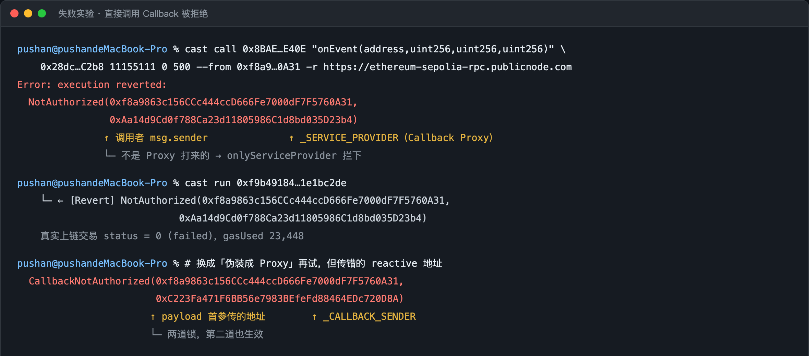

# D4【必做】跨链回调三步走（场景 2 · 钱包守护）

> 任务：跨链回调三步走（120 学分，必做）· 2026-11-22
> 学习目标：把「看到事件」变成「在另一条链上做事」，以**钱包守护 / 报警**为例
> 链路：**Ethereum Sepolia（源链 · 监控转出）→ Lasna（Reactive 判断）→ Ethereum Sepolia（目标链 · 告警合约执行）**
> 全部测试网，未混用主网；Reactive 侧统一 Lasna；赛道 1 不强制两条链。

---

## 提交项 ①：三笔交易链接

### 1. 源链事件 —— 我的热钱包转出 2000 CTT

https://sepolia.etherscan.io/tx/0x6924bb9525dbe3faf9a1cdd94680edc6e4bb1ce96ad6392aabd7742c751ac2df

| 项 | 值 |
|---|---|
| 区块 | 12189139（2026-11-22 21:48:24 UTC+8） |
| 合约 | `TestToken` `0x4c8c127D8BBc7E64F52a2c693582ae3816172802` |
| 事件 | `Transfer(from=0xf8a9…0A31, to=0x…dEaD, value=2000e18)` |
| topic0 | `0xddf252ad1be2c89b69c2b068fc378daa952ba7f163c4a11628f55a4df523b3ef` |
| topic1（from） | `0x…f8a9863c156ccc444ccd666fe7000df7f5760a31` ← **订阅就是靠这个钉死的** |

### 2. Reactive 上 react() 执行

https://lasna.reactscan.net/tx/0x7ce17b478a02563409f608520c0d4b668c9fd83cbedfbb1096e6e966db298dbe

| 项 | 值 |
|---|---|
| 区块 | 8978601（21:48:25，比源链晚 **1 秒**） |
| 合约 | `GuardReactive` `0x28dca0F84ba51E3c25Aa54466F2aF5C365c6C2b8` |
| 发出事件 | `Seen(token, 2000e18, alerted=true, remaining=1)`、`AlertRequested(11155111, 0x8BAE…E40E, 2000e18)` |

### 3. 目标链回调 —— 告警合约真的被调用了

https://sepolia.etherscan.io/tx/0xec3f13a5ea0dd14f9cacd7ae4e6f0c97d38ad02d506f65ad9a55c4219e5d4fce

| 项 | 值 |
|---|---|
| 区块 | 12189140（21:48:36，比 react 晚 **11 秒**） |
| 合约 | `GuardCallback` `0x8BAEbd783F97785aEFb4ce8451B0F05E98e5E40E` |
| 事件 | `Guarded(token=0x4c8c…2802, amount=2000e18, originTxHash=0x6924bb95…ac2df, seq=1, atTimestamp=1795355316)` |

**数据一致性**：回调里的 `originTxHash` = `0x6924bb95…ac2df`，与第 ① 笔**逐位一致**。

**延迟实测**

| 分段 | 耗时 |
|---|---|
| 源链事件块 → Lasna react 块 | **1 秒** |
| Lasna react 块 → 目标链回调块 | **11 秒**（Sepolia 出块 12s） |
| 端到端 | **12 秒** |

**目标链状态**：`alerts = 1`、`lastAmount = 2000e18`、`lastAlertAt = 1795355316`
**Reactive 侧状态**：`matched = 2`、`remaining = 0`（次数用完 → **已自动退订**）

---

## 提交项 ②：失败实验

### 真实上链的失败交易

用我自己的钱包**直接调用** `GuardCallback.onEvent()`（绕过 Callback Proxy）：

https://sepolia.etherscan.io/tx/0xf9b49184577883d448167782d80e33ac10bf31ab4aff06eceb5ed23b1e1bc2de

| 项 | 值 |
|---|---|
| status | **0 (failed)** |
| gasUsed | 23,448 |
| from | `0xf8a9863c156CCc444ccD666Fe7000dF7F5760A31` |
| to | `0x8BAEbd783F97785aEFb4ce8451B0F05E98e5E40E` |
| revert | `NotAuthorized(0xf8a9…0A31, 0xAa14…23b4)` |



### 一句话解释为什么被拒

> **`onEvent()` 的第一道锁 `onlyServiceProvider` 要求 `msg.sender` 必须是 Callback Proxy；我用自己的钱包直接调用，`msg.sender` 是我的地址而不是 Proxy `0xAa14d9Cd…23b4`，所以立刻 revert `NotAuthorized(调用者, 期望的 Provider)`，函数体一行都没执行。**

### 两道锁都做了对照验证

| 实验 | 调用者 | payload 首参（reactive） | 结果 |
|---|---|---|---|
| A（真实交易） | 我的钱包 `0xf8a9…` | 正确 `0x28dc…` | ❌ `NotAuthorized` ← 第一道锁 |
| B（`cast call --from` 模拟） | 模拟 Proxy `0xAa14…` | 错误 `0xf8a9…` | ❌ `CallbackNotAuthorized` ← 第二道锁 |
| C（`cast call --from` 模拟） | 模拟 Proxy `0xAa14…` | 正确 `0x28dc…` | ✅ 通过（返回 `0x`） |

实验 C 是关键对照：同样的调用者、同样的函数，只把地址换成正确的就通过——证明不是函数坏了，是鉴权在正常工作。

---

## 这一版和「模板跑一遍」的区别

模板的 `CampOrigin.ping()` 是自造事件，只能证明「链路能通」。这一版按**场景 2** 做，多了三处真实要素：

| | 模板五步 | 本版（场景 2） |
|---|---|---|
| 源链事件 | 自己 emit 的 `Ping` | **真实 ERC-20 `Transfer`** |
| 订阅过滤 | 合约 + topic0 | 合约 + topic0 + **topic1 = 我的钱包**（只听自己的转出） |
| 阈值 | 有（模板自带） | 有，且**低于阈值不消耗次数**（10 CTT 被过滤，`filtered=1`） |
| 目标链动作 | 只 `count += 1` | 记录金额、源交易哈希、**时间戳**，emit `Guarded` |
| 结果 | count=1 | alerts=1，且 Reactive 侧自动退订 |

### 订阅条件（这是场景 2 的核心）

```solidity
SYSTEM.subscribe(
    11155111,                                  // Sepolia
    token,                                     // 精确到代币合约
    ERC20_TRANSFER_TOPIC_0,                    // Transfer(address,address,uint256)
    uint256(uint160(hotWallet)),               // topic1 = from = 我的热钱包 ← 只听自己的转出
    REACTIVE_IGNORE,                           // topic2（to）不关心
    REACTIVE_IGNORE                            // topic3 不存在
);
```

**为什么要钉 topic1**：场景 2 只关心「我的钱出去了」。别人转给我、或者别的地址之间互转，都不该唤醒我的合约——每条通知都要花钱。把 `from` 钉死，等于让节点帮我做第一层过滤。

---

## 要求逐条对照

| 任务要求 | 实现 | 证据 |
|---|---|---|
| 源链和目标链都用测试网 | Sepolia ↔ Lasna ↔ Sepolia | 三笔交易均在测试网浏览器 |
| Reactive 侧统一 Lasna | `5318007` | Reactscan 链接 |
| Callback 继承 `AbstractCallback` | `contract GuardCallback is AbstractCallback` | 源码 |
| 第一个参数是 `address` | `onEvent(address reactive_, address token_, uint256 amount_, uint256 originTxHash_)` | 源码 + 回调事件 |
| 同时加 `onlyServiceProvider` + `onlyCallbackSender` | 两个修饰符都在函数签名上 | 源码 + 失败实验 A/B/C |
| Callback Proxy 用官方 Origins & Destinations 地址 | `0xAa14d9Cd0f788Ca23d11805986C1d8bd035D23b4` | 回调真实落地 |
| 回调合约有余额 | 部署时带 0.01 ETH | `alerts=1` 说明没被欠费拦住 |
| 再做一次失败实验 | 真实交易 + 两个模拟对照 | 见上 |

---

## 过程中踩到的三个坑（都是真事故）

### 1. 回调 gas 请求 400,000，Proxy 只转发 155,006 → `OutOfGas`

第一版 `CALLBACK_GAS_LIMIT = 400_000`，`onEvent` 里 4 个 SSTORE（每个 22.1k）直接把 gas 烧光。

`cast run` 的 trace：

```
├─ [214278] 0xF11D…::deliverCallback(… gasLimit 0x061a80 = 400000 …)
│   ├─ [155006] 0x234E…::onEvent(…)
│   │   └─ ← [OutOfGas] EvmError: OutOfGas
```

**原因**（D2 查到的文档原话）：Proxy 在调用接收方之前，会先扣掉 `_extraGas`(150k) 和 `_maxChargeGas`(50k) 以及自身开销，**只把剩下的转发出去**。

改成 `1_000_000` 后成功。**这条是模板用 1e6 的真正原因，不是随手写的。**

### 2. `_CALLBACK_SENDER` 是 immutable，填错只能重新部署

重新部署 `GuardReactive` 后，我忘了重新载入环境变量就去部署 `GuardCallback`，结果新回调合约里记的还是**旧** reactive 地址：

```
Reactive 实际 : 0x28dca0F84ba51E3c25Aa54466F2aF5C365c6C2b8
回调合约记的  : 0xB1B35c042Ffc71DF87EAf13CA9854008eE0eAf30   ← 旧地址
```

表现是回调**已投递但执行失败**（`CallbackNotAuthorized`），而且失败也收费（余额从 0.01 掉到 0.009999999997）。

只能重新部署回调合约。这正是 FAQ Q8 那个坑。

### 3. 部署预算不足时，`forge script` 会留一个「未完成广播」

第一次部署 `GuardReactive` 时 lREACT 只有 0.1109，而估算要 0.1698 → 交易没发出去，但 forge 留下了 `broadcast/Guard.s.sol/5318007/run-latest.json`。之后再跑就报：

```
Error: the previous broadcast ... has unfinished operations;
finish it with `--resume`, or pass `--start-fresh`
```

处理：先换币补足余额（转 0.01 Sepolia ETH → 1.05 lREACT），再 `--start-fresh` 重跑。

---

## 复现命令

```bash
cd reactive-builder-camp/starter
set -a; source .env; set +a

export GUARD_FUND=40000000000000000            # 0.04 lREACT 预付
export GUARD_CALLBACK_FUND=10000000000000000   # 0.01 ETH
export GUARD_THRESHOLD=1000000000000000000000  # 1000 CTT
export GUARD_LIMIT=2

forge script script/Guard.s.sol:DeployGuardReactive  --rpc-url $LASNA_RPC_URL --broadcast
# 把地址写进 .env 并【重新 source】，再跑下一步——否则 _CALLBACK_SENDER 会绑错
set -a; source .env; set +a

forge script script/Guard.s.sol:DeployGuardCallback  --rpc-url $SEPOLIA_RPC_URL --broadcast
set -a; source .env; set +a

forge script script/Guard.s.sol:SetGuardRecipient    --rpc-url $LASNA_RPC_URL --broadcast

export OUTFLOW_SMALL=10000000000000000000
forge script script/Guard.s.sol:GuardSmall --rpc-url $SEPOLIA_RPC_URL --broadcast   # 10 CTT，被过滤

export OUTFLOW_BIG=2000000000000000000000
forge script script/Guard.s.sol:GuardBig   --rpc-url $SEPOLIA_RPC_URL --broadcast   # 2000 CTT，触发

# 失败实验（预期 revert，用 --gas-limit 绕过估算才能上链）
cast send $GUARD_CALLBACK_ADDR "onEvent(address,address,uint256,uint256)" \
  $GUARD_REACTIVE_ADDR $TOKEN_ADDR 2000 0 \
  --rpc-url $SEPOLIA_RPC_URL --private-key $PRIVATE_KEY --gas-limit 120000
```

---

## 附：模板五步那套（Ping）也是有效证据

同一链路的另一组独立记录（11/13）：

| 环节 | 交易 |
|---|---|
| 源链 `ping(500)` | [0x85a95c13…](https://sepolia.etherscan.io/tx/0x85a95c13d86737122cd43d74d053f31dd9d7acd7ed2875ae4eea56b3177b618e) |
| Lasna `react()` | [0x0c1b80e0…](https://lasna.reactscan.net/tx/0x0c1b80e089cf4f4e4ac964d5b2a98486a413f463eabc29e8a43bc008b26ea9f9) |
| 目标链回调 | [0xda56e835…](https://sepolia.etherscan.io/tx/0xda56e83572d8763085d115960280baf743197e293dcee99a59075b95d98673dc) |

---

## 一句话总结

> 源链 `emit` → Lasna 上 `react()` 判断阈值 → 请求回调 → Proxy 注入 reactive 地址并投递 → 目标链 `onEvent` 过两道锁后执行动作。
> **实测端到端 12 秒；回调 gas 必须留足（Proxy 会先扣 ~200k）；`_CALLBACK_SENDER` 填错只能重新部署。**
