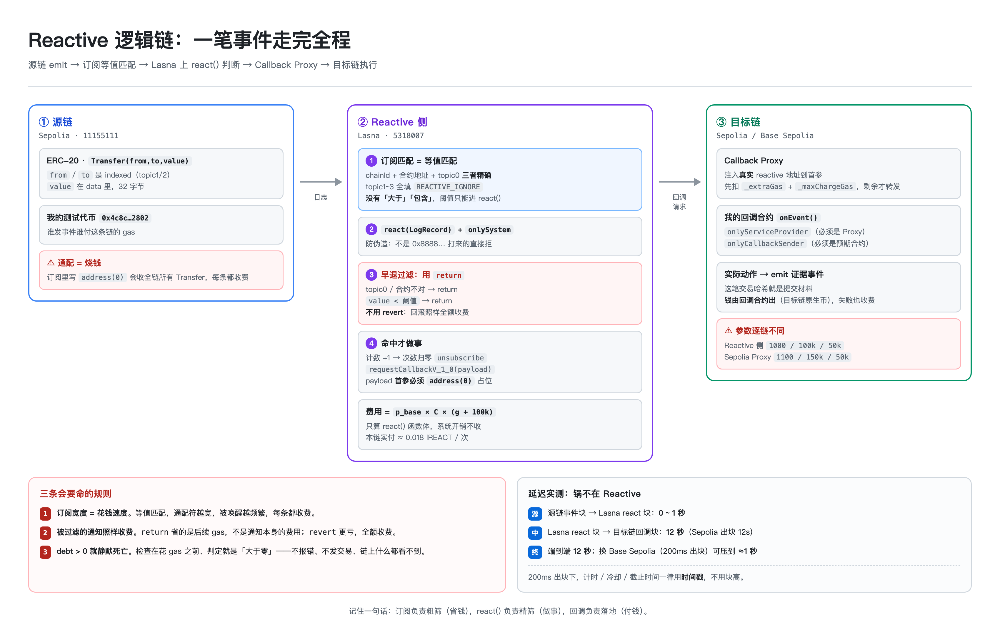

# 总结区

> 以后所有复盘、速查图、概念总结都放这个文件夹，方便随时翻。

---

## 一图看懂：Reactive 逻辑链



> 一句话：**订阅负责粗筛（省钱），`react()` 负责精筛（做事），回调负责落地（付钱）。**

### 这张图要你记住的 5 个点

| # | 位置 | 要点 |
|---|---|---|
| 1 | 源链 | 事件发射方付 gas；订阅里写 `address(0)` = 收全链所有 Transfer = 烧钱 |
| 2 | 订阅 | **只支持等值匹配**（chainId + 合约 + topic0），没有「大于」，阈值只能进 `react()` |
| 3 | react() | `onlySystem` 防伪造；过滤用 `return` 不用 `revert`（回滚照样全额收费） |
| 4 | 回调 | payload 首参必须 `address(0)` 占位；两道校验；**钱由回调合约出** |
| 5 | 死亡条件 | `debt > 0` 在花 gas 之前就拦下 → **静默停止，不报错** |

### 延迟：锅不在 Reactive

| 分段 | 耗时 |
|---|---|
| 源链事件块 → Lasna react 块 | **0 ~ 1 秒** |
| Lasna react 块 → 目标链回调块 | **12 秒**（Sepolia 出块 12s） |
| 端到端 | **12 秒**；换 Base Sepolia（200ms）可压到 ≈1 秒 |

---

## 怎么修改这张图

图是用 HTML + CSS 排版的，源文件是 [`logic-chain.html`](logic-chain.html)，改完重新渲染即可：

```bash
cd summary

# 改 logic-chain.html 后，重新生成 PNG
"/Applications/Google Chrome.app/Contents/MacOS/Google Chrome" \
  --headless=new --disable-gpu --no-sandbox --hide-scrollbars \
  --user-data-dir=/tmp/chrome-prof2 --force-device-scale-factor=2 \
  --window-size=1700,1075 --screenshot="$PWD/logic-chain.png" \
  "file://$PWD/logic-chain.html"
```

- `--force-device-scale-factor=2` 输出 2 倍图（3400×2150），放大也清晰
- `--window-size` 的第二个数控制高度，内容变多就调大它（否则底部会被切）

---

## 本文件夹的约定

| 文件 | 用途 |
|---|---|
| `README.md` | 索引 + 当前最重要的那张图 |
| `logic-chain.png` | 逻辑链总图（渲染产物） |
| `logic-chain.html` | 逻辑链总图（可编辑源文件） |

新加总结时的建议命名：

```
summary/
├── logic-chain.png/html      # 逻辑链总图（已有）
├── fee-model.png             # 费用模型图（如需要）
└── week1-review.md           # 第 1 周复盘
```

---

## 详细笔记在这里

图是速查，细节在 `notes/`：

| 笔记 | 内容 |
|---|---|
| [concepts-summary.md](../notes/concepts-summary.md) | **核心概念复盘 + 7 道自测题**（配这张图看） |
| [d2-fees.md](../notes/d2-fees.md) | 费用公式推导、balance/reserves/debt、revert 收费 |
| [d3-first-deploy.md](../notes/d3-first-deploy.md) | 订阅写法、通配陷阱、上链实测数据 |
| [d1-use-case.md](../notes/d1-use-case.md) | 用例拆解：钱包守护 |
| [2026-11-13.md](../notes/2026-11-13.md) | 首个端到端三步走（三笔交易哈希） |
